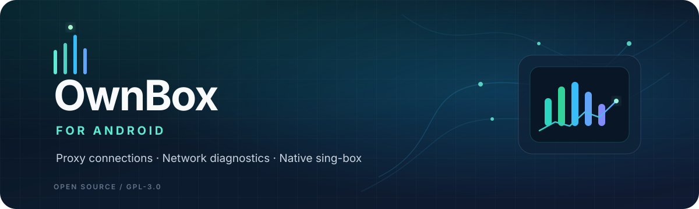

  
   
  <h1>OwnBox for Android</h1>
  
<strong>把连接、诊断与管理，收进一个简洁的 Android 客户端。</strong>

  
基于原生 sing-box 内核打造的多协议代理客户端与网络诊断工具。

  

    
    
    
    
  

  

    
    
    
  

  

    Android 5.0+ · Kotlin + Go · sing-box v1.15.0-alpha.13 · Open Source
  

---

## ✦ 项目简介

**OwnBox** 是一款面向 Android 的现代化代理客户端与网络诊断工具。项目基于原生 **sing-box** 内核进行适配与扩展，将多协议节点管理、真实连接延迟测试、分应用路由、网络服务连通性检测、WebDAV 备份与系统快捷操作整合到同一个应用中。

我们希望它不只是一个“能连接”的客户端，也是一套方便观察网络状态、管理配置并快速定位连接问题的日常工具。

> **项目定位：** OwnBox 是客户端软件，不内置或提供第三方代理订阅。实际连接速度、稳定性以及各网站/服务的可用状态，会受到设备、网络环境、节点质量和服务端策略等因素影响。

## ✨ 核心功能

<table>
  <tr>
    <td width="50%" valign="top">
      <h3>🚀 原生内核与极速调优</h3>
      
基于官方 sing-box v1.15.0 纯 Go 原生 TUN 栈打造，更低内存与待机功耗；优化并发拨号与 Telegram 直连，消除首次缓冲并保障分流优先生效。

    </td>
    <td width="50%" valign="top">
      <h3>📡 真实连接与带宽测试</h3>
      
支持 URL 延迟测试、分组测速与连接状态反馈，主页底部卡片支持全区域轻触即刻重测，按需遵循落地 IP 显示设置。

    </td>
  </tr>
  <tr>
    <td width="50%" valign="top">
      <h3>🧭 网络诊断中心</h3>
      
集中检测常见网站、AI 服务与主流流媒体平台的连通性，支持分类筛选、单项重新检测及出站 IP 详情弹窗。

    </td>
    <td width="50%" valign="top">
      <h3>🎯 路由规则与远程规则集</h3>
      
采用结构化规则编辑体系；内置 2,300+ 项远程规则集可视化搜索多选，支持自定义 .srs 订阅与定时自动拉取更新。

    </td>
  </tr>
  <tr>
    <td width="50%" valign="top">
      <h3>🔔 实况通知岛与灵动胶囊</h3>
      
深度适配 Android 原生实况通知与状态栏灵动胶囊，提供 15 款变量引擎、多套预设与通知栏一键切流操作。

    </td>
    <td width="50%" valign="top">
      <h3>📐 界面与字体自由缩放</h3>
      
新增独立可视化调节中心，支持忽略系统大字号、全局双滑块微调，以及顶栏、分组栏、抽屉、节点卡片与底栏 6 大分区独立缩放。

    </td>
  </tr>
  <tr>
    <td width="50%" valign="top">
      <h3>🎨 丰富主题与个性化</h3>
      
高对比纯白/浅灰规范主题，全面支持 Android 12+ 莫奈动态壁纸取色与 18 款 Material 多彩主题；支持桌面图标跟随系统深浅色切换。

    </td>
    <td width="50%" valign="top">
      <h3>☁️ 备份、同步与分应用</h3>
      
支持 WebDAV 备份与同步配置；提供侧边栏一键直达分应用代理管理、快捷设置磁贴及桌面小组件支持。

    </td>
  </tr>
</table>

## 🧪 网络诊断支持范围

当前版本的网络诊断中心涵盖以下 13 项常见服务：

| 类别 | 检测目标 |
|:--|:--|
| 搜索与开发 | Google、GitHub |
| 视频与流媒体 | YouTube、Netflix、Disney+、Prime Video、Spotify、TikTok |
| AI 服务 | ChatGPT、Claude、Gemini |
| 社区与其他 | Discord、哔哩哔哩（Bilibili） |

检测结果用于了解测试时的网络连通性与响应情况，**不等于保证账号可用、内容可播放或服务一定解锁**。不同网络、地区、账号和服务策略可能产生不同结果。

## 📥 下载与安装

### 最新版本

  

建议优先打开 [**GitHub Releases 最新发布页**](https://github.com/Own716/OwnBoxForAndroid/releases/latest)，查看当前版本的说明、安装包与校验文件。

### 当前稳定版 v26.11.8 安装包

> **版本号说明**：版本号采用「年.月.日」命名规范，`v26.11.8` 为最新发布的正式版（全面整合了包括三维智能分流、代理模式控制面板、网络诊断重构、全规格桌面小组件及 Solar 图标规范在内的全部功能增强与稳定性修复）。

| 架构 | 适用设备 | 下载 | 校验 |
|:--|:--|:--:|:--:|
| **ARM64 (v8a)** · 推荐 | 大多数现代 Android 手机与平板 | [下载 APK](https://github.com/Own716/OwnBoxForAndroid/releases/download/v26.11.8/OwnBox-26.11.8-arm64-v8a-release.apk) | [SHA-256](https://github.com/Own716/OwnBoxForAndroid/releases/download/v26.11.8/sha256sums.txt) |
| **armeabi-v7a** | 较旧的 32 位 Android 设备 | [下载 APK](https://github.com/Own716/OwnBoxForAndroid/releases/download/v26.11.8/OwnBox-26.11.8-armeabi-v7a-release.apk) | [SHA-256](https://github.com/Own716/OwnBoxForAndroid/releases/download/v26.11.8/sha256sums.txt) |
| **x86_64** | 64 位 Android 模拟器 | [下载 APK](https://github.com/Own716/OwnBoxForAndroid/releases/download/v26.11.8/OwnBox-26.11.8-x86_64-release.apk) | [SHA-256](https://github.com/Own716/OwnBoxForAndroid/releases/download/v26.11.8/sha256sums.txt) |
| **x86** | 32 位 Android 模拟器 | [下载 APK](https://github.com/Own716/OwnBoxForAndroid/releases/download/v26.11.8/OwnBox-26.11.8-x86-release.apk) | [SHA-256](https://github.com/Own716/OwnBoxForAndroid/releases/download/v26.11.8/sha256sums.txt) |

> **如何选择？** 一般手机请选择 `ARM64 (v8a)`。如果不确定设备架构，请先查看设备信息；不要仅凭 Android 版本号判断 CPU 架构。

### 安装步骤

1. 打开最新发布页，下载与设备架构匹配的 APK。
2. 按系统提示完成安装；若系统要求，允许当前安装来源安装应用。
3. 首次使用时，按应用内指引授予 VPN 权限，再导入自己的节点或订阅配置。
4. 遇到连接异常时，可先运行节点延迟测试和网络诊断，再提交问题反馈。

## 🧩 技术栈

| 组件 | 说明 |
|:--|:--|
| Android | 原生 Android 客户端，最低支持 Android 5.0（API 21） |
| Kotlin | Android 应用主要开发语言 |
| Go / `libcore` | 集成与适配 sing-box 核心能力 |
| sing-box | 当前仓库配置版本为 `v1.15.0-alpha.13` |
| GitHub Actions | 自动化构建与发布流程 |

## 🔐 安全与签名说明

- 请优先从本仓库的 [**官方 Releases**](https://github.com/Own716/OwnBoxForAndroid/releases/latest) 下载当前发布版本，并核对发布页提供的 SHA-256 文件。
- 仓库的 [安全策略（SECURITY.md）](SECURITY.md) 明确说明：**2026 年 9 月之前历史提交中出现的旧 `release.keystore` 或凭据应视为已泄露且不可信**。不要将历史签名材料用于当前发布，也不要仅凭旧签名判断历史 APK 可信。
- 发现可复现的安全问题时，请参考 [SECURITY.md](SECURITY.md) 中的说明处理；普通功能问题与建议可提交至 [GitHub Issues](https://github.com/Own716/OwnBoxForAndroid/issues)。

## 🗺️ 项目文档

- [所有发布版本与更新说明](https://github.com/Own716/OwnBoxForAndroid/releases)
- [更新日志（CHANGELOG.md）](CHANGELOG.md)
- [发布说明（RELEASE_NOTES.md）](RELEASE_NOTES.md)
- [安全策略（SECURITY.md）](SECURITY.md)
- [GPL-3.0 许可证](LICENSE)

## 💬 社区、反馈与参与

- **Telegram 社区：** [@OwnBoxs](https://t.me/OwnBoxs)
- **问题反馈：** [提交 GitHub Issue](https://github.com/Own716/OwnBoxForAndroid/issues)
- **源码与贡献：** 欢迎阅读代码、反馈可复现的问题，或通过 Pull Request 参与改进。

提交问题时，建议附上应用版本、Android 版本、设备架构、网络类型、复现步骤，以及经过脱敏处理的相关日志。请勿公开分享订阅链接、节点密码、访问令牌、私钥或其他敏感信息。

## 📄 许可证

本项目采用 [GNU General Public License v3.0（GPL-3.0）](LICENSE) 许可证。使用、分发或修改代码前，请阅读许可证正文及相关上游组件的许可要求。

---

  
<strong>OwnBox · Connect clearly. Diagnose confidently.</strong>

  
如果 OwnBox 对你有帮助，欢迎点亮 ⭐ Star、提交反馈，或加入 Telegram 社区。

  
<strong>English</strong> — Show the English overview

  

    <h2>OwnBox for Android</h2>
    
<strong>A modern Android proxy client and network diagnostics toolkit.</strong>

    
Built around the native sing-box core, OwnBox brings together multi-protocol connections, node latency tests, per-app routing, service connectivity checks, WebDAV backup and Android system shortcuts.

    

      <a href="https://github.com/Own716/OwnBoxForAndroid/releases/latest">Download latest release</a> ·
      <a href="https://github.com/Own716/OwnBoxForAndroid/issues">Report an issue</a> ·
      <a href="https://t.me/OwnBoxs">Telegram community</a>
    

  

  ### Highlights

  - **Native Core & Performance:** pure Go sing-box v1.15 TUN stack, staggered dial, zero-delay Telegram media routing & KeepAlive.
  - **Remote Rule Sets:** Modern structured rule editor, 2,300+ built-in remote .srs rulesets with search & auto-updates.
  - **Live Update & Island:** native Android Live Update ongoing notifications & status bar capsules with 15 dynamic variables.
  - **Granular UI Scaling:** independent system-font ignore toggle, dual global sliders and 6-region fine-grained scale controls.
  - **Service & Speed Checks:** TCP Ping, group URL & bandwidth testing, and 13-target service connectivity diagnostics.
  - **Theming & Personalization:** Monet wallpaper color extraction, 18 Material themes, high-contrast white/gray styles, and dynamic app icons.

  ### Downloads

  Visit the [latest Releases page](https://github.com/Own716/OwnBoxForAndroid/releases/latest) for current APKs, release notes and checksums. For most modern Android phones, choose **ARM64 (v8a)**. Other packages target older 32-bit devices or Android emulators.

  ### Important security note

  The repository's [SECURITY.md](SECURITY.md) states that historical `release.keystore` files and credentials appearing in commits before September 2026 are compromised and untrusted. Download current builds from the official Releases page and do not reuse historical signing materials.

  OwnBox is a client application and does not provide third-party proxy subscriptions. Connectivity, speed and service availability depend on the device, network, server and service-side policies.

  ### License & community

  Licensed under [GPL-3.0](LICENSE). Visit [GitHub Issues](https://github.com/Own716/OwnBoxForAndroid/issues) for bug reports and suggestions, or join [@OwnBoxs on Telegram](https://t.me/OwnBoxs).

