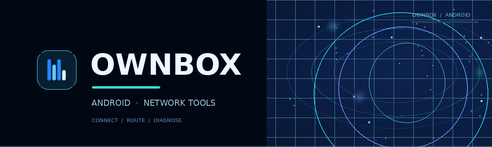

  
   
  <picture>
    <source media="(prefers-color-scheme: dark)" srcset="docs/assets/ownbox-mark-dark.png" />
    <source media="(prefers-color-scheme: light)" srcset="docs/assets/ownbox-mark-light.png" />
    
  </picture>
  <h1>OwnBox for Android</h1>
  
<strong>把连接、路由与诊断，收进一个简洁的 Android 客户端。</strong>

  
基于 sing-box 的 Android 网络工具、代理配置客户端与网络诊断工具。

  

    
    
    
  

  

    <a href="https://ownbox.pages.dev">项目官网</a> ·
    <a href="https://github.com/Own716/OwnBoxForAndroid">GitHub 仓库</a> ·
    <a href="https://t.me/OwnBoxs">Telegram 社区</a> ·
    <a href="https://github.com/Own716/OwnBoxForAndroid/releases">下载 Releases</a>
  

---

## 推荐服务

以下内容为社区资源推荐，方便有需要的用户自行了解。推荐服务均由第三方独立运营，与 OwnBox 项目无隶属、担保或联合运营关系。

<table>
  <tr>
    <td width="50%" valign="top">
      <strong>吹雪云</strong> 
      第三方网络服务 · 邀请注册入口  
      <a href="https://xn--9kqs1lo79d.com/#/register?code=A6m5cmqx">注册入口</a>　|　<a href="https://t.me/KarenOwn/225">套餐详情</a>
    </td>
    <td width="50%" valign="top">
      <strong>Kitty Network</strong> 
      第三方网络服务 · 邀请注册入口  
      <a href="https://kitty.do/register?invite=zAVUhvIu">注册入口</a>　|　<a href="https://t.me/KarenOwn/22">套餐详情</a>
    </td>
  </tr>
  <tr>
    <td width="50%" valign="top">
      <strong>一分机场</strong> 
      第三方网络服务 · 邀请注册入口  
      <a href="https://xn--4gqx1hgtfdmt.com/#/register?code=abupDu6P">注册入口</a>　|　<a href="https://t.me/KarenOwn/45">套餐详情</a>
    </td>
    <td width="50%" valign="top">
      <strong>NIVA</strong> 
      第三方网络服务 · 邀请注册入口  
      <a href="https://niva.lol/r/OwnBox">注册入口</a>　|　<a href="https://t.me/KarenOwn/148">套餐详情</a>
    </td>
  </tr>
</table>

> **购买提示：** 服务内容、套餐价格、节点信息、可用性与退款规则均以服务商页面公布的信息为准。购买前请自行阅读套餐详情、服务条款和隐私政策，并评估持续订阅及跨境网络服务的相关风险。OwnBox 不参与第三方服务的交付、收费或售后。

## 账号资源

提供 TG 账号、Apple ID、TikTok、X 等账号资源，涵盖多种类型；具体库存、地区、价格与交付方式以对应平台页面为准。

<table>
  <tr>
    <td width="50%" valign="top">
      <strong>低价平台</strong> 
      账号资源与商品信息  
      <a href="https://tgttgg.cc.cd/">访问 tgttgg.cc.cd</a>
    </td>
    <td width="50%" valign="top">
      <strong>更多种类</strong> 
      更多类型的账号资源  
      <a href="https://own.maitg.com/">访问 own.maitg.com</a>
    </td>
  </tr>
</table>

> **风险提示：** 购买或使用第三方账号可能涉及账号来源、原始持有人找回、地区限制、实名要求、平台封禁及售后争议等风险。请先核实商品描述与平台规则，不要购买或使用来源不明、未经授权或违反目标平台服务条款的账号。以上平台与 OwnBox 项目独立运营。

---

## 项目简介

**OwnBox for Android** 是一款面向 Android 的网络工具，围绕代理配置、连接管理、流量路由和网络诊断进行整合。项目基于 **sing-box** 核心构建，并在 Android 端提供图形化操作界面，帮助用户管理自己的节点与订阅、调整分流策略，并检查常见网络服务的连通状态。

OwnBox 是客户端软件，**不内置或销售第三方代理订阅，也不提供代理节点**。用户需要自行准备合法、可信的服务配置。

### 项目入口

| 资源 | 地址 |
|:--|:--|
| 项目官网 | [ownbox.pages.dev](https://ownbox.pages.dev) |
| GitHub 仓库 | [Own716/OwnBoxForAndroid](https://github.com/Own716/OwnBoxForAndroid) |
| Releases 下载 | [GitHub Releases](https://github.com/Own716/OwnBoxForAndroid/releases) |
| Telegram 社区 | [@OwnBoxs](https://t.me/OwnBoxs) |
| 问题反馈 | [GitHub Issues](https://github.com/Own716/OwnBoxForAndroid/issues) |

## 核心功能展示

<table>
  <tr>
    <td width="50%" valign="top">
      <strong>连接与速度测试</strong> 
      节点延迟检测、分组 URL 测试与带宽测试入口，帮助观察连接表现。
    </td>
    <td width="50%" valign="top">
      <strong>网络诊断中心</strong> 
      按类别检查常见 AI、流媒体、社交及开发服务的网络连通状态，并支持单项或批量重测。
    </td>
  </tr>
  <tr>
    <td width="50%" valign="top">
      <strong>智能分流与路由</strong> 
      支持应用、域名与 IP 维度的分流配置，提供规则编辑、远程规则集与分应用代理入口。
    </td>
    <td width="50%" valign="top">
      <strong>配置备份与恢复</strong> 
      支持配置导入导出，并提供 WebDAV 备份与恢复能力，便于迁移和保存配置。
    </td>
  </tr>
  <tr>
    <td width="50%" valign="top">
      <strong>主题与界面定制</strong> 
      提供深浅色及多种主题外观，并包含桌面小组件、快捷设置磁贴等系统入口。
    </td>
    <td width="50%" valign="top">
      <strong>策略组与连接管理</strong> 
      支持自动选择策略组、实时监控与手动锁定，并提供原生「分流连接」监控、智能启停与订阅 HWID 支持。
    </td>
  </tr>
</table>

## 下载与安装

请优先通过 **[GitHub Releases 官方发布页](https://github.com/Own716/OwnBoxForAndroid/releases/latest)** 下载。发布页会列出当前版本说明、安装包和可用的校验文件。

当前正式 Release 页面提供以下架构的安装包：

| 架构 | 适用设备 | 建议 |
|:--|:--|:--|
| `arm64-v8a` | 大多数现代 Android 手机和平板 | 一般手机优先选择 |
| `armeabi-v7a` | 部分较旧的 32 位 ARM 设备 | 确认设备 ABI 后选择 |
| `x86_64` | 64 位 Android 模拟器或 x86 设备 | 按模拟器架构选择 |
| `x86` | 32 位 Android 模拟器或 x86 设备 | 按模拟器架构选择 |

### 安装步骤

1. 打开 [Releases 最新发布页](https://github.com/Own716/OwnBoxForAndroid/releases/latest)。
2. 阅读当前版本说明，下载与设备 CPU 架构匹配的 APK。
3. 按 Android 系统提示完成安装；如系统要求，允许当前安装来源安装应用。
4. 首次启动并导入自己的节点或订阅配置。建立 VPN 连接时，按系统弹窗授予 VPN 连接权限。
5. 如遇到连接问题，先运行节点测试或网络诊断，再按下方说明提交反馈。

> **版本说明（截至 2026-11-24）：** GitHub 最新正式 Release 为 `v26.11.24`，内核配置为 `sing-box v1.15.0-alpha.13`。普通用户建议直接以 Releases 页面标记的正式版本为准。

## 使用与问题反馈

### 提交问题前建议准备

如遇到可复现的异常或功能问题，请通过 [GitHub Issues](https://github.com/Own716/OwnBoxForAndroid/issues) 提交。建议尽量附上以下信息，便于定位问题：

- OwnBox 版本号，以及安装包来源（正式版 / 预览版）。
- Android 版本、设备型号与 CPU 架构。
- 当前网络类型（Wi-Fi / 移动网络）、代理模式和相关路由设置。
- 具体复现步骤、预期结果、实际结果及必要的脱敏日志。

**请勿在公开 Issue 或群聊中粘贴完整订阅链接、节点密码、UUID、访问令牌、私钥、账号密码、WebDAV 凭据或其他敏感信息。**

问题反馈：[GitHub Issues](https://github.com/Own716/OwnBoxForAndroid/issues) · 社区交流：[Telegram @OwnBoxs](https://t.me/OwnBoxs)

## 安全与免责声明

1. **下载来源：** 请优先从本仓库的 [GitHub Releases](https://github.com/Own716/OwnBoxForAndroid/releases) 获取安装包，并核对发布页提供的 SHA-256 校验信息。不要安装来源不明的二次打包版本。
2. **历史签名材料：** 仓库 [SECURITY.md](https://github.com/Own716/OwnBoxForAndroid/blob/main/SECURITY.md) 明确指出，2026 年 9 月之前历史提交中出现的 `release.keystore` 文件或凭据应视为已泄露且不可信。它们不得用于生产发布或信任判断。
3. **第三方服务：** 本 README 中的机场与账号资源链接由第三方独立运营。OwnBox 不对其商品真实性、服务质量、可用性、价格、退款或售后作出保证。
4. **网络与账号风险：** 代理连接、访问速度、服务可用性及第三方平台账号状态会受到设备、网络、服务端策略、地区规则和账号状态等因素影响。诊断结果仅供参考。
5. **合规使用：** 用户应遵守所在地区适用法律法规、目标网站/平台服务条款及第三方服务规则，并自行承担配置、连接和交易行为所产生的责任。
6. **开源许可：** 本项目采用 [GNU General Public License v3.0](https://github.com/Own716/OwnBoxForAndroid/blob/main/LICENSE)。使用、修改或再分发前，请阅读许可证及上游组件的许可要求。

---

  <strong>OwnBox · Connect clearly. Diagnose confidently.</strong> 
  如果 OwnBox 对你有帮助，欢迎点亮 Star、提交反馈或加入 Telegram 社区。

  
<strong>English — Show the English overview</strong>

  ## OwnBox for Android

  OwnBox is an Android networking utility, proxy configuration client and network diagnostics toolkit built around the **sing-box** core. It brings together profile and subscription management, connection testing, application/domain/IP routing, service reachability checks, configuration backup and Android system shortcuts.

  ### Key capabilities

  - **Connection testing:** node latency checks, URL-based group tests and bandwidth test entry points.
  - **Network diagnostics:** categorized connectivity checks for selected AI, streaming, social and developer services, with individual and batch retesting.
  - **Routing:** application-, domain- and IP-based routing configuration, editable rules, remote/local rule sets and per-app proxy controls.
  - **Strategy groups & live connections:** unified auto-select engine (fastest/most stable, priority tiers, and failover), built-in strategy monitor with manual pinning, and optional native real-time connections monitor.
  - **Backup and restore:** local configuration import/export and WebDAV backup/restore support.
  - **Customization:** theme options, home-screen widgets and Quick Settings entry points.

  ### Download

  Get the current official build from [GitHub Releases](https://github.com/Own716/OwnBoxForAndroid/releases/latest). Choose the APK matching your device ABI. The repository's current formal release page provides ARM64, armeabi-v7a, x86_64 and x86 packages.

  The latest formal release is `v26.11.24` as of November 24, 2026 (powered by `sing-box v1.15.0-alpha.13`). Refer to the Releases page for the build intended for general use.

  ### Important notes

  OwnBox is a client application. It does not bundle or sell third-party proxy subscriptions or nodes. Network performance and service availability depend on the device, network, remote server and service-side policies. Diagnostic results do not guarantee account access or content availability.

  The repository's [SECURITY.md](https://github.com/Own716/OwnBoxForAndroid/blob/main/SECURITY.md) warns that historical `release.keystore` files or credentials appearing in commits before September 2026 are compromised and must not be trusted or reused. Download builds from the official Releases page and verify the published SHA-256 checksums.

  The recommended proxy and account-resource services listed above are independently operated by third parties and are not affiliated with OwnBox. Review their terms and risks before making a purchase.

  ### Links

  - [Website](https://ownbox.pages.dev)
  - [GitHub repository](https://github.com/Own716/OwnBoxForAndroid)
  - [Releases](https://github.com/Own716/OwnBoxForAndroid/releases)
  - [Telegram community](https://t.me/OwnBoxs)
  - [Issue tracker](https://github.com/Own716/OwnBoxForAndroid/issues)

  Licensed under [GPL-3.0](https://github.com/Own716/OwnBoxForAndroid/blob/main/LICENSE).

